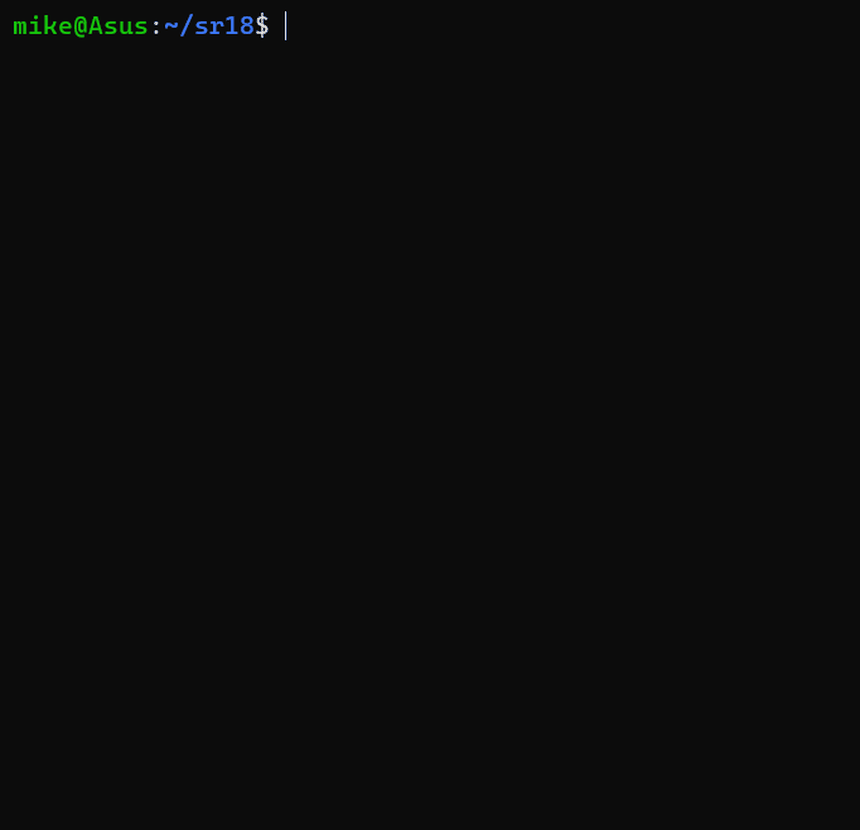
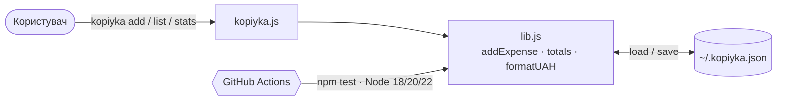

<div align="center">

# 🪙 Копійка

**Облік витрат у гривнях прямо в терміналі — без таблиць, реєстрацій і реклами.**

[](https://github.com/mykhailokrainiak/startup-readme/actions/workflows/test.yml)
[](LICENSE)


[](#contributing)




[Можливості](#features) · [Швидкий старт](#quick-start) · [Використання](#usage) · [Як це працює](#architecture) · [Roadmap](#roadmap) · [FAQ](#faq)

</div>

---

<a id="features"></a>
## ✨ Можливості

| | Функція | Опис |
|:-:|---|---|
| ➕ | Додавання витрат | `kopiyka add 85 кава капучино` — сума, категорія, нотатка |
| 📋 | Журнал | `kopiyka list` — усі записи з датами |
| 📊 | Статистика | `kopiyka stats` — суми за категоріями з графіком у терміналі |
| 🇺🇦 | Гривні «як треба» | `1 200,00 грн`, кома в сумі, нерозривні пробіли |
| 🔒 | Офлайн | дані лише у локальному JSON-файлі, жодних серверів |

<a id="quick-start"></a>
## 🚀 Швидкий старт

```bash
git clone https://github.com/mykhailokrainiak/startup-readme.git
cd startup-readme
npm test                      # переконатися, що все працює
node kopiyka.js add 85 кава   # перша витрата
```

> [!TIP]
> Додайте аліас у `~/.bashrc`, щоб запускати просто `kopiyka`:
> `alias kopiyka="node ~/startup-readme/kopiyka.js"`

<a id="usage"></a>
## 🧾 Використання

| Команда | Результат |
|---|---|
| `kopiyka add <сума> <категорія> [нотатка]` | додає витрату, сума може бути з комою: `420,50` |
| `kopiyka list` | таблиця всіх витрат |
| `kopiyka stats` | підсумки за категоріями та загальна сума |

```text
$ kopiyka stats
транспорт  ████████████████████ 1 200,00 грн
продукти   ███████              420,50 грн
кава       ████                 235,00 грн
Разом                           1 855,50 грн
```

> [!WARNING]
> Від'ємні суми та порожня категорія відхиляються: `✖ Сума має бути додатним числом`.

Файл даних за замовчуванням — `~/.kopiyka.json`; інший шлях задається змінною `KOPIYKA_FILE`.

<a id="architecture"></a>
## 🧩 Як це працює



| Порівняння | Таблиця Excel | Мобільний застосунок | **Копійка** |
|---|:-:|:-:|:-:|
| Запис витрати за 3 секунди | ❌ | ⚠️ | ✅ |
| Працює без інтернету | ✅ | ⚠️ | ✅ |
| Без реєстрації та реклами | ✅ | ❌ | ✅ |
| Відкритий код | ❌ | ❌ | ✅ |

<a id="roadmap"></a>
## 🗺️ Roadmap

- [x] Додавання, журнал і статистика витрат
- [x] Тести та CI на трьох версіях Node.js
- [ ] Бюджети на категорії з попередженням про перевищення
- [ ] Експорт у CSV для бухгалтерії
- [ ] Місячні звіти: <kbd>kopiyka</kbd> <kbd>report</kbd> <kbd>--month</kbd>

<a id="faq"></a>
## ❓ FAQ

<details>
<summary><b>Де зберігаються мої дані?</b></summary>

Лише локально у JSON-файлі (`~/.kopiyka.json`). Програма не робить жодних мережевих запитів.
</details>

<details>
<summary><b>Чи можна вести кілька гаманців?</b></summary>

Так: задайте різні файли через змінну середовища, наприклад `KOPIYKA_FILE=~/travel.json kopiyka list`.
</details>

<a id="contributing"></a>
## 🤝 Внесок у проєкт

1. Створіть issue з описом ідеї або помилки.
2. Зробіть форк і гілку `feature/назва`.
3. Переконайтеся, що `npm test` проходить, і відкрийте pull request.

## 📄 Ліцензія

[MIT](LICENSE) © 2026 Михайло Крайняк[^1]

[^1]: Проєкт створено в межах самостійної роботи з дисципліни «Проєктний практикум», група 451.
